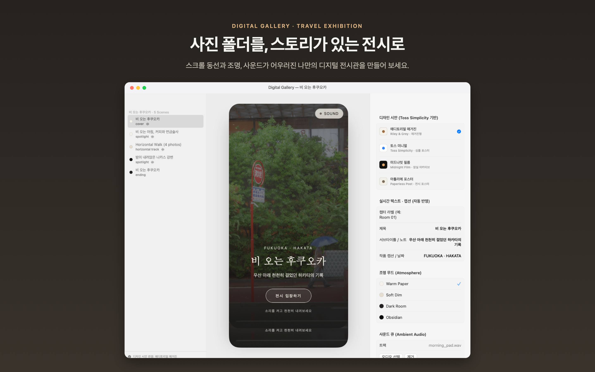
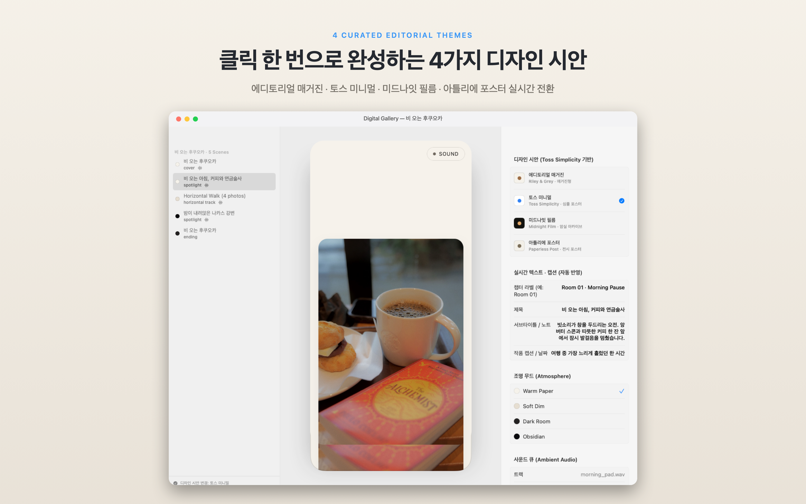
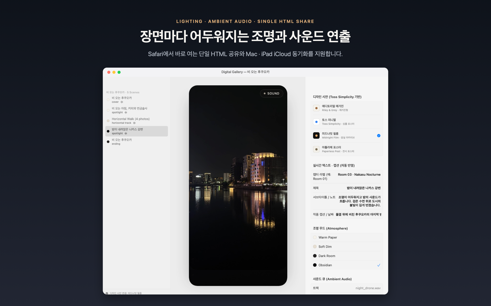
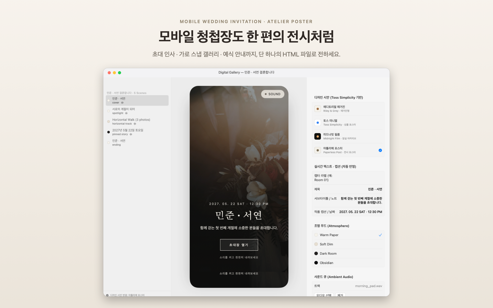

# Digital Gallery

> **"사진을 저장하는 앱이 아니라, 사진을 하나의 경험으로 만들어내는 앱."**

Apple 생태계(macOS · iPadOS)에 최적화된 개인용 디지털 전시관 제작 도구입니다.  
**Rust Core + UniFFI + SwiftUI + iCloud Drive (`.gallery` Document Package)** 아키텍처로 설계되어 있으며, 스크롤 동선·조명 변화·앰비언트 사운드·캡션이 어우러진 독립형 HTML 전시관을 생성합니다.

## Preview Screenshots (App Store 2880×1800)



| 4가지 디자인 시안 실시간 전환 | 조명 암전 · 사운드 · 단일 HTML 공유 |
| :---: | :---: |
|  |  |

### 모바일 청첩장 예시 (`Our_Wedding_2027.gallery` · Atelier Poster 테마)



## App Store Release Kit

App Store Connect 제출에 필요한 프로젝트·메타데이터·스크린샷 자료가 저장소에 포함되어 있습니다.

- **스크린샷 (2880×1800, 16:10)**: [`apps/xcode/AppStoreScreenshots/`](apps/xcode/AppStoreScreenshots/)
- **App Store Connect 메타데이터 · 심사 노트 · 배포 가이드**: [`docs/app-store-release.md`](docs/app-store-release.md)
- **Xcode 프로젝트 & 설정**: [`apps/xcode/project.yml`](apps/xcode/project.yml) · [`Info.plist`](apps/xcode/Resources/Info.plist) · [`PrivacyInfo.xcprivacy`](apps/xcode/Resources/PrivacyInfo.xcprivacy) · [`AppIcon`](apps/xcode/Resources/Assets.xcassets/AppIcon.appiconset/)
- **아카이브 & 업로드 스크립트**: [`scripts/archive-appstore.sh`](scripts/archive-appstore.sh) · [`apps/xcode/ExportOptions.plist`](apps/xcode/ExportOptions.plist)

## Features

- **EXIF 자동 큐레이션 (`gallery-media`)**: 폴더 내 사진/영상의 촬영 시각과 가로·세로 비율을 분석해 챕터를 나누고 전시 씬을 자동 제안
- **6종 전시 씬 모델 (`gallery-core`)**: `Cover`, `Spotlight`, `HorizontalTrack`(세로→가로 Sticky 스크롤), `PinnedStory`(연속 보간 스토리), `VideoMoment`, `Ending`
- **4종 에디토리얼 디자인 시안 (`gallery-export`)**: 토스 심플리시티 원칙을 반영한 `Editorial Magazine`, `Toss Minimal`, `Midnight Film`, `Atelier Poster` 실시간 무중단 전환
- **실전 미디어 최적화 & 단일 HTML 공유**: 최대 2048px 자동 리사이즈·EXIF 회전 보정, OG 메타태그, AirDrop/iOS 파일에서도 바로 열리는 단일 Self-Contained HTML 내보내기
- **Apple 네이티브 편집기 (`apps/apple` & `apps/xcode`)**: `WKWebView` 무중단 라이브 패치, `Cmd+Z` Undo/Redo, `PhotosPicker`, `NSFileCoordinator` 기반 iCloud Drive `.gallery` 동기화, macOS + iPadOS `GalleryFFI.xcframework` 지원

## Workspace Structure

```text
digital-gallery/
├── crates/
│   ├── gallery-core/      # 전시관 데이터 모델, 6종 씬, 조명/사운드, 4종 테마
│   ├── gallery-media/     # 폴더 스캔, EXIF 분석, 시간대별 클러스터링 & 씬 추천
│   ├── gallery-export/    # Tera HTML 렌더러, 이미지 최적화, 단일 HTML 번들러, Web Audio 런타임
│   ├── gallery-ffi/       # UniFFI Swift 바인딩 및 XCFramework 코어
│   └── gallery-cli/       # CLI (scan / build / demo)
├── apps/
│   ├── apple/             # SwiftPM 공용 브릿지(GalleryBridge) & SwiftUI 편집기
│   └── xcode/             # App Store 배포용 macOS/iPadOS Xcode 프로젝트 (project.yml)
├── scripts/
│   ├── build-swift-bridge.sh
│   ├── build-xcframework.sh
│   └── archive-appstore.sh
└── docs/
    └── app-store-release.md
```

## Quick Start

### 1. Build Rust Core & Swift XCFramework

```bash
./scripts/build-xcframework.sh
```

### 2. Run the Native macOS SwiftUI App

```bash
swift run --package-path apps/apple DigitalGalleryApp
```

### 3. CLI Usage (Folder → Single-File HTML)

```bash
# 1) 사진 폴더 스캔 및 manifest.json 초안 생성
cargo run -- scan /path/to/your/photos --title "비 오는 후쿠오카"

# 2) AirDrop / Safari 공유용 단일 HTML 생성
cargo run -- build /path/to/your/photos/manifest.json --out ./exhibition --single-file
open ./exhibition/exhibition-single.html
```

## License

This project is licensed under the **GNU Affero General Public License v3.0 (AGPL-3.0)** — see the [LICENSE](LICENSE) file for details.

- 코드는 개인·상업적 용도 모두 자유롭게 사용, 수정, 배포할 수 있습니다.
- 단, 본 코드를 수정하거나 포함해 앱 또는 웹/네트워크 서비스로 상업적·비상업적 배포를 할 경우, **동일한 AGPL-3.0 라이선스로 전체 소스코드를 무료 공개**해야 합니다.
