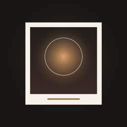
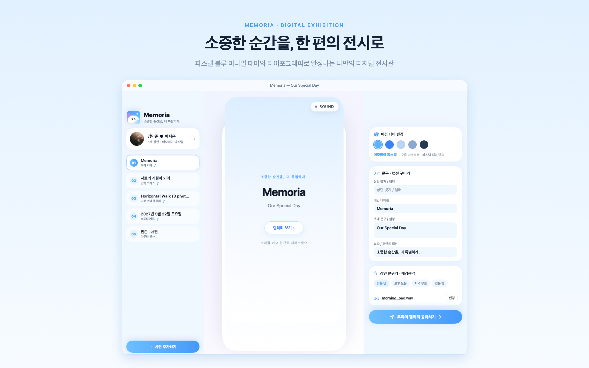
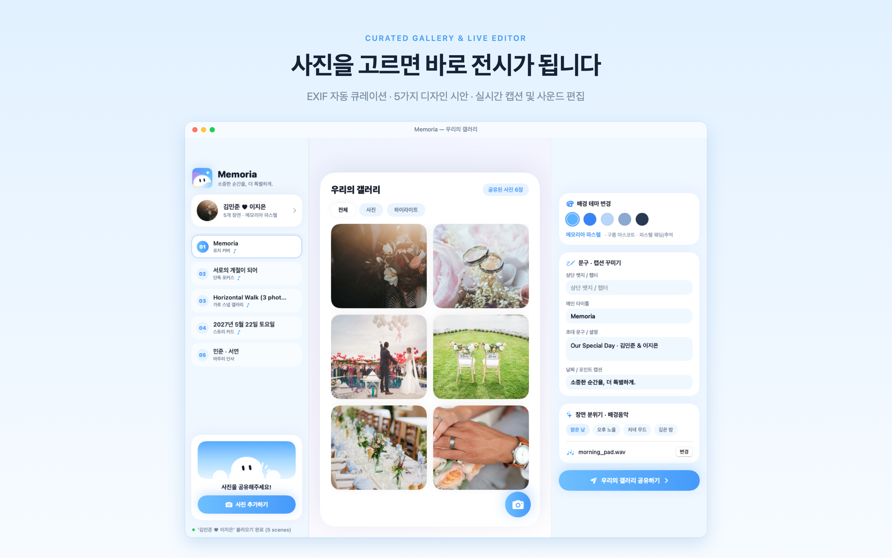
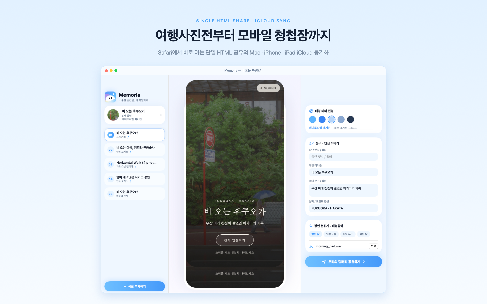
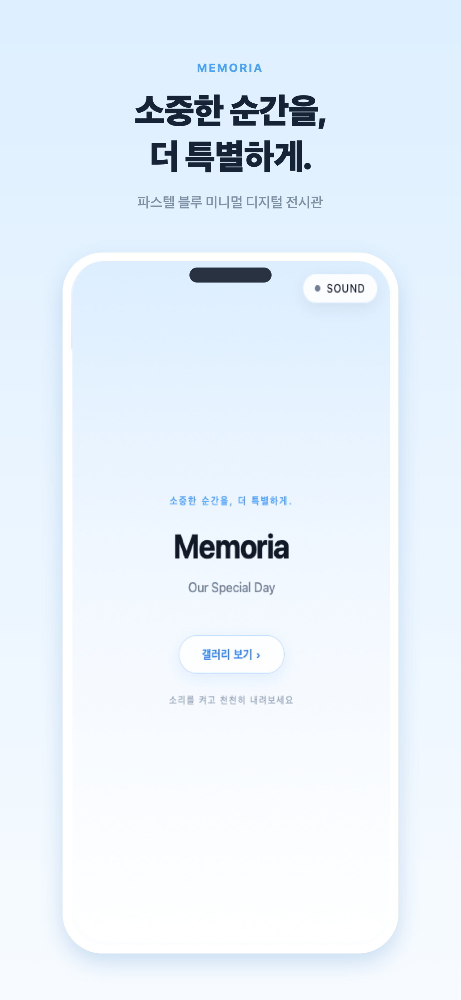
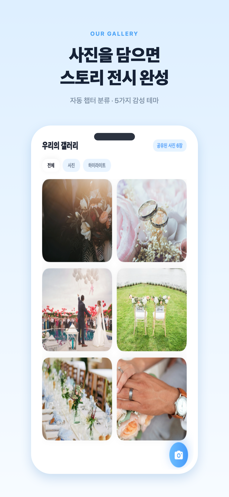
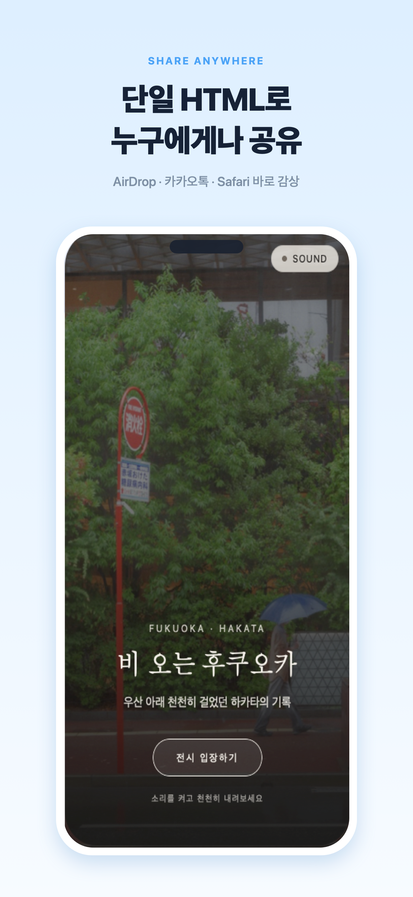

<p align="center">
  
</p>

<h1 align="center">Memoria (Digital Gallery)</h1>

<p align="center">
  <strong>소중한 순간을, 더 특별하게.</strong><br/>
  사진을 저장하는 앱이 아니라, 사진을 하나의 전시 경험으로 만들어내는 Apple 네이티브 디지털 전시관 제작 도구
</p>

---

## App Store Preview Screenshots

### Mac App Store (`2880 × 1800`, 16:10)



| 우리의 갤러리 & 실시간 편집 | 여행사진전 · 단일 HTML 공유 |
| :---: | :---: |
|  |  |

### iPhone App Store (`1290 × 2796`, 6.7" Display)

| 파스텔 블루 미니멀 커버 | 우리의 갤러리 그리드 | 단일 HTML 공유 & 여행전 |
| :---: | :---: | :---: |
|  |  |  |

---

## App Store Release Kit

App Store Connect 제출에 필요한 프로젝트·아이콘·스크린샷·심사 서류가 모두 정리되어 있습니다.

- **iOS 스크린샷 (1290×2796, 6.7"):** [`apps/xcode/AppStoreScreenshots/iOS/`](apps/xcode/AppStoreScreenshots/iOS/)
- **macOS 스크린샷 (2880×1800, 16:10):** [`apps/xcode/AppStoreScreenshots/macOS/`](apps/xcode/AppStoreScreenshots/macOS/)
- **앱 아이콘 세트 (16px~1024px):** [`apps/xcode/Resources/Assets.xcassets/AppIcon.appiconset/`](apps/xcode/Resources/Assets.xcassets/AppIcon.appiconset/)
- **App Store Connect 메타데이터 · 프라이버시 · 심사 노트:** [`docs/app-store-release.md`](docs/app-store-release.md)
- **Xcode 프로젝트 & 심사 필수 설정:** [`apps/xcode/project.yml`](apps/xcode/project.yml) · [`Info.plist`](apps/xcode/Resources/Info.plist) · [`PrivacyInfo.xcprivacy`](apps/xcode/Resources/PrivacyInfo.xcprivacy) · [`ExportOptions.plist`](apps/xcode/ExportOptions.plist)
- **서명 · 아카이브 스크립트:** [`scripts/archive-appstore.sh`](scripts/archive-appstore.sh)

---

## Architecture & Features

**Rust Core + UniFFI (`GalleryFFI.xcframework`) + SwiftUI + iCloud Drive (`.gallery` Document Package)**

- **EXIF 자동 큐레이션 (`gallery-media`)**: 폴더 내 사진/영상의 촬영 시각과 가로·세로 비율을 분석해 챕터와 전시 씬을 자동 제안
- **6종 전시 씬 모델 (`gallery-core`)**: `Cover`, `Spotlight`, `HorizontalTrack`(세로→가로 Sticky 스크롤), `PinnedStory`(연속 보간 스토리), `VideoMoment`, `Ending`
- **5종 디자인 시안 (`gallery-export`)**: `Memoria Pastel Blue`, `Toss Minimal`, `Editorial Magazine`, `Atelier Poster`, `Midnight Film` 실시간 무중단 전환
- **실전 미디어 최적화 & 단일 HTML 공유**: 최대 2048px 자동 리사이즈·EXIF 회전 보정, OG 메타태그, AirDrop/카카오톡/Safari에서 바로 여는 단일 Self-Contained HTML 내보내기
- **Apple 네이티브 편집기 (`apps/apple` & `apps/xcode`)**: `WKWebView` 무중단 라이브 패치, `Cmd+Z` Undo/Redo, `PhotosPicker`, `ShareLink`, `NSFileCoordinator` 기반 `.gallery` 패키지 동기화

## Quick Start

```bash
# 1. Rust Core + macOS/iOS XCFramework 빌드
./scripts/build-xcframework.sh

# 2. macOS SwiftUI 앱 실행
swift run --package-path apps/apple DigitalGalleryApp

# 3. iOS / macOS 서명 아카이브 & .ipa 추출
./scripts/archive-appstore.sh ipados <YOUR_APPLE_TEAM_ID>
```

## License

This project is licensed under the **GNU Affero General Public License v3.0 (AGPL-3.0)** — see the [LICENSE](LICENSE) file for details.

- 코드는 개인·상업적 용도 모두 자유롭게 사용, 수정, 배포할 수 있습니다.
- 단, 본 코드를 수정하거나 포함해 앱 또는 웹/네트워크 서비스로 상업적·비상업적 배포를 할 경우, **동일한 AGPL-3.0 라이선스로 전체 소스코드를 무료 공개**해야 합니다.
